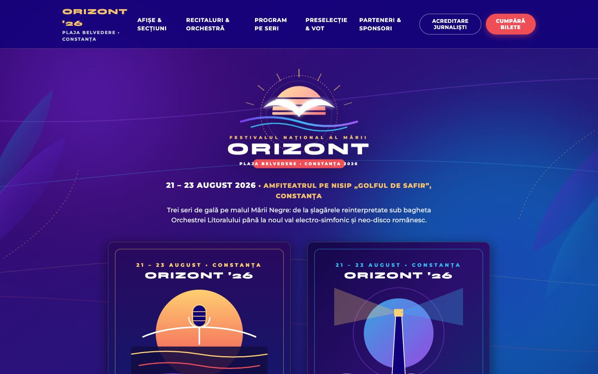
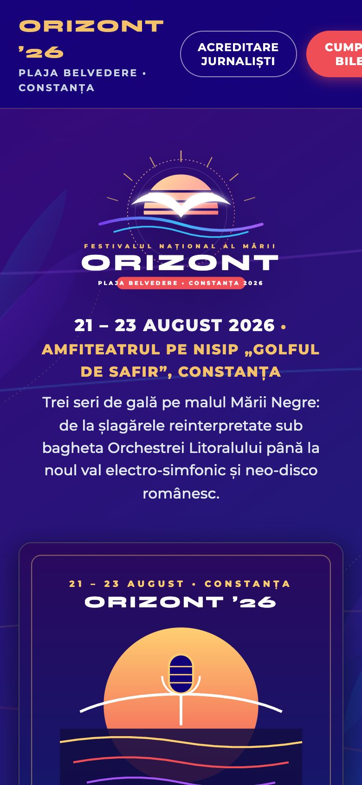
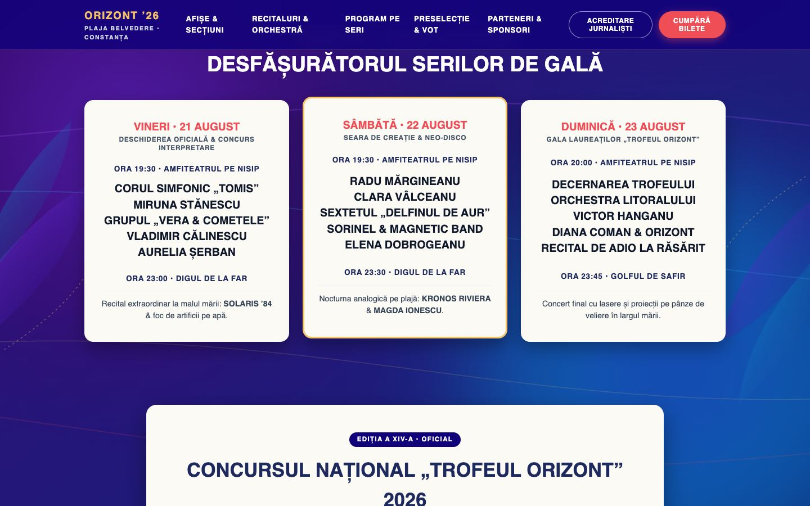

# Festivalul Orizont

Site pentru un festival de muzică pe plajă: program, preselecție, vot și bilete demo.

> Proiect demonstrativ. Firma, adresa, telefoanele, emailurile și recenziile sunt fictive. Orice asemănare cu o firmă reală este întâmplătoare.

## Capturi de ecran

| Prima pagină, telefon | Programul festivalului |
|---|---|
|  |  |

## Tehnologii

HTML, CSS și JavaScript simplu.

## Decizii tehnice

- Fundalul cu valuri de lumină e desenat pe un canvas 2D și se redimensionează odată cu fereastra.
- Biletele și acreditarea sunt formulare demonstrative, fără plată reală.
- Logo-ul e SVG, deci rămâne clar la orice mărime.
- Accesibilitate: mesaje anunțate cititoarelor de ecran (aria-live).

## Rulare

Site static: deschide `index.html` în browser sau rulează un server local, de exemplu `npx serve .`.

## Cum a fost realizat

Proiectul a fost conceput și dezvoltat de Cristian Lucaci. În procesul de creație am folosit și instrumente de inteligență artificială, ca sprijin la scrierea codului, la texte și la verificări. Deciziile de design, alegerile tehnice și forma finală îmi aparțin.

## Licență

Codul este publicat sub licența [MIT](LICENSE), © 2026 Cristian Lucaci.

Resursele terțe incluse (fonturi, biblioteci, fotografii sau modele 3D cu licență liberă) își păstrează licențele proprii, menționate lângă fișiere sau în pagină. Imaginile fără sursă menționată sunt grafică generată pentru acest proiect.
